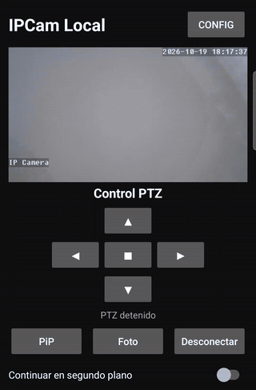
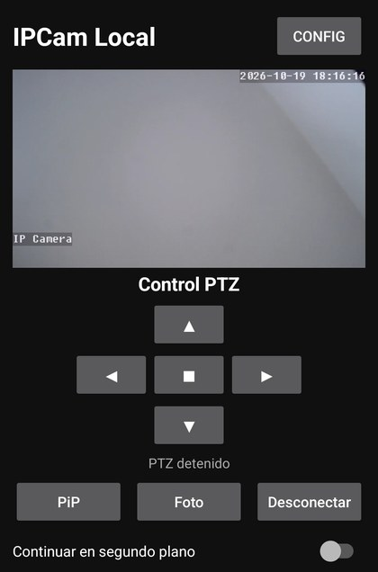
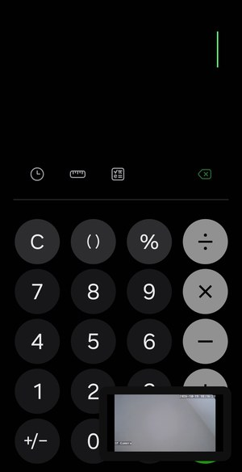
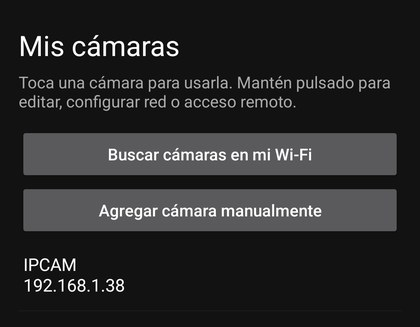
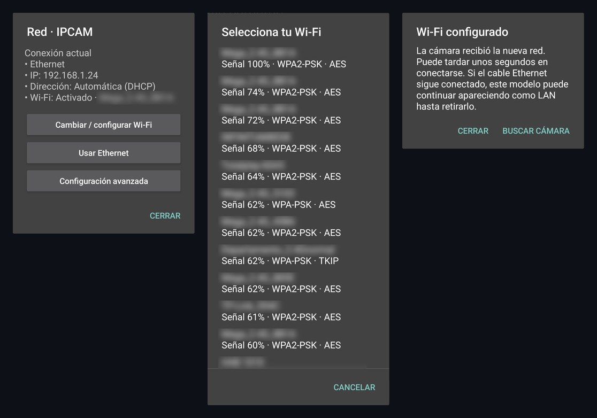
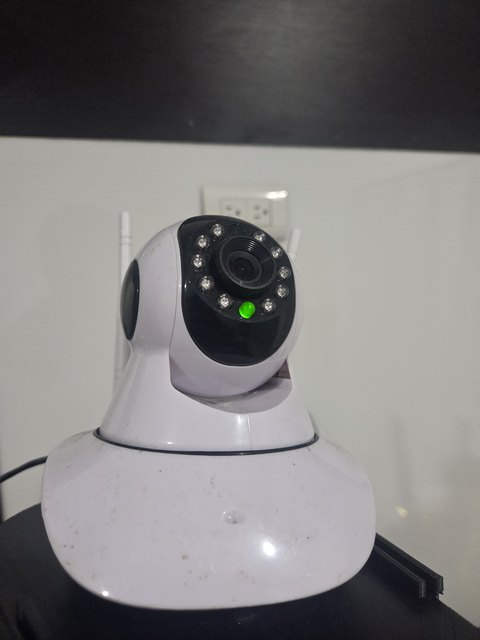

# IPCamLocal

[](https://github.com/ErubielG/ipcamlocal/actions/workflows/android.yml)


[](LICENSE)

**An Android client for Wi-Fi/Ethernet IP cameras: live RTSP video, PTZ control, Wi-Fi setup
and automatic IP recovery — no accounts, no cloud, no paywall.**

<p align="center">
  
  &nbsp;&nbsp;
  
</p>

## Why I built it

My PTZ camera had no free app that worked with it; the only compatible one was behind a
paywall. So I researched what it actually takes to talk to a Wi-Fi camera directly — RTSP for
video, ONVIF for control, and the camera's own firmware API for its network settings — and
built my own client.

Every release was tested on the real camera, one change at a time.

## What it does

The app's interface is in Spanish; the code, docs and this README are in English.

**Video and control**
- Live RTSP video (LibVLC) with automatic reconnection and a connection watchdog.
- PTZ pad over ONVIF: tap for a small step, hold to keep moving.
- Fullscreen in landscape, pinch-to-zoom (1x–4x) with pan, and snapshots to the gallery.
- Picture-in-Picture and an optional background mode that keep the **same** stream alive.

**Cameras and network**
- Finds ONVIF cameras on the local network (WS-Discovery) and reads their stream URL and PTZ
  profile automatically.
- Saves several cameras; passwords are encrypted with the Android Keystore.
- Moves a camera from Ethernet to Wi-Fi from inside the app, using the camera's own CGI API.
- Recognizes each camera by its ONVIF UUID, so it finds it again when the router gives it a
  new IP.

| Picture-in-Picture | Saved cameras | Wi-Fi setup (network names blurred) |
|:---:|:---:|:---:|
|  |  |  |

## Engineering highlights

Real problems from this project, each written up with the symptom, the evidence and the fix:

| | Problem | What solved it |
|---|---|---|
| 1 | [The video kept pushing every control off screen](docs/case-studies/01-libvlc-video-layout.md) | Disassembled LibVLC 3.7.6 and found `VLCVideoLayout` forcing its own size to `MATCH_PARENT`; a 16:9 parent now owns the height. |
| 2 | [The build failed in a tool I didn't write](docs/case-studies/02-codeassist-d8-heap.md) | Compared with the last version that built and changed one variable: the Gradle heap. |
| 3 | [Ethernet → Wi-Fi with no docs and no official app](docs/case-studies/03-hi3510-wifi-and-ip-recovery.md) | Queried the camera's Hi3510 CGI from the browser and Termux, then built the flow and UUID-based rediscovery. |
| 4 | ["Background off" still kept the video running](docs/case-studies/04-pip-ignored-background-toggle.md) | Automatic PiP ignored the switch; now every path checks it. |
| 5 | [Stream rejected right after connecting](docs/case-studies/05-rtsp-missing-credentials.md) | A sanitized diagnostic line (`credentials=no`) pointed to an empty user field. |
| 6 | [Short PTZ taps didn't move the camera](docs/case-studies/06-ptz-move-stop-order.md) | Serialized `Move`/`Stop` on one thread with a 280 ms minimum. |

The hardest part for me was #3: getting information out of a camera with no documentation,
from Termux and the browser, and turning that into a Wi-Fi setup that works from the app.

## Architecture

One `CameraSession` owns LibVLC and the RTSP connection. The screen, Picture-in-Picture and the
background service attach to that same session instead of opening their own.

```
MainActivity ─┐                    ┌─ OnvifClient (SOAP + WS-Security: PTZ, profiles)
              ├─ CameraSession ────┤
Background  ──┘   (LibVLC, RTSP)   └─ OnvifDiscovery (WS-Discovery multicast)
Service
CamerasActivity ── Hi3510CgiClient (LAN / Wi-Fi) · SQLite profiles · Keystore credentials
```

More in [docs/architecture.md](docs/architecture.md).

**Stack:** Java · Android SDK (API 23–35) · LibVLC 3.7.6 · ONVIF / SOAP · WS-Security ·
WS-Discovery · Hi3510 CGI · SQLite · Android Keystore · JUnit · GitHub Actions

## Tested on



- A real Wi-Fi PTZ camera (Hi3510 firmware family, pictured) and a Samsung Android phone.
- What was verified in each release: [docs/validation.md](docs/validation.md).

**Limits, honestly:** one camera model and one phone so far. The Hi3510 network setup is
specific to that firmware family; the ONVIF path exists for other cameras but hasn't been
validated with another brand yet.

<br clear="right">

## Build

```bash
./gradlew testDebugUnitTest assembleDebug
```

JDK 17 and the Android SDK are required. It also builds on an Android phone with CodeAssist —
that's how it was developed. Details in [docs/building.md](docs/building.md).

## Roadmap

- **Remote viewing over a VPN** (Tailscale on an always-on PC), instead of opening router ports.
- **2.0:** React Native + TypeScript with a redesigned UI, so it also runs on iOS. This Java
  version stays as the tested reference.

## Development notes

Developed and built on an Android phone with CodeAssist. AI assistants (ChatGPT, Claude) were
used as coding aids; the problem, the investigation on the real camera and the validation of
each release are mine.

## License

[GPL-3.0](LICENSE). Uses [LibVLC](https://code.videolan.org/videolan/vlc-android)
(LGPL-2.1+). Fullscreen icons from [Material Icons](https://fonts.google.com/icons)
(Apache 2.0).

---

**Jesús Erubiel Borboa García** · Mechatronics Engineering student · Mazatlán, Mexico ·
[GitHub](https://github.com/ErubielG)
