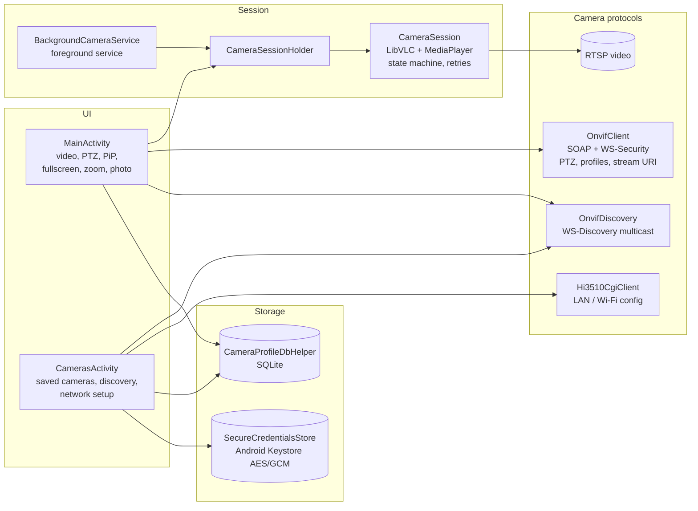
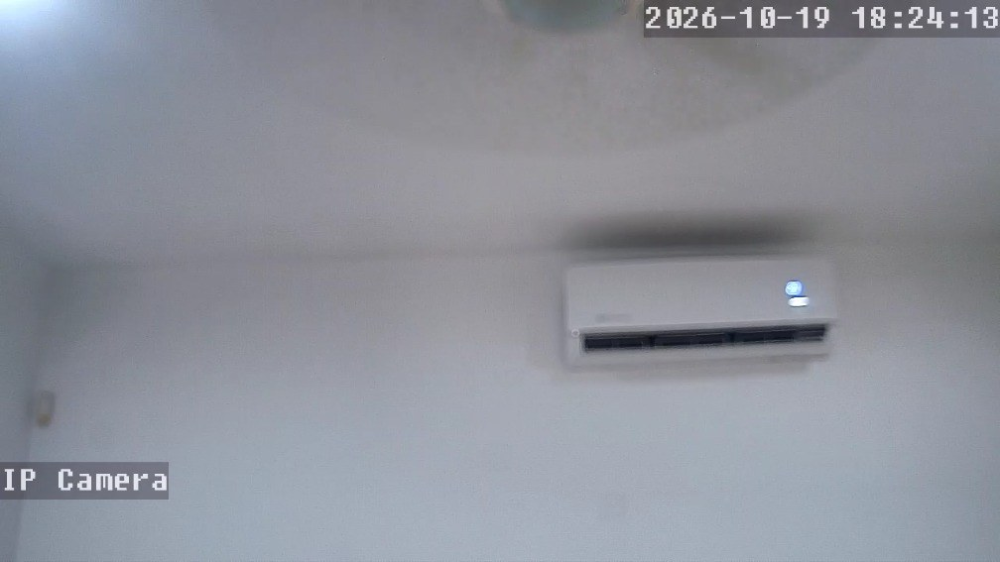

# Architecture

IPCamLocal is a single-module Android app written in Java. The design goal was simple:
**one RTSP connection per camera, owned by one object**, no matter whether the video is on
screen, in Picture-in-Picture, or running in the background.

## Components

| Component | Responsibility |
|---|---|
| `MainActivity` | Connection screen and camera view: video, PTZ pad, PiP, background toggle, fullscreen, pinch-to-zoom, snapshots. Recovers a camera that changed IP (see below). |
| `CameraSession` | **The only owner of LibVLC and `MediaPlayer`.** States: `IDLE`, `CONNECTING`, `PLAYING`, `WAITING_RETRY`, `PAUSED`, `ERROR`, `DISCONNECTED_MANUALLY`, `RELEASED`. Attaches/detaches the video surface without dropping the stream. |
| `CameraSessionHolder` | Shares the same `CameraSession` between the Activity and the background service. |
| `BackgroundCameraService` | Foreground service (`mediaPlayback`) with a persistent notification. Keeps the **same** session alive; it never opens a second RTSP connection. |
| `CamerasActivity` | Saved cameras, WS-Discovery search, add/edit, network setup (Ethernet ↔ Wi-Fi) and the "view away from home" guidance. |
| `OnvifClient` | SOAP over HTTP with WS-Security `UsernameToken` digest: `GetCapabilities`, `GetProfiles`, `GetStreamUri`, `ContinuousMove`, `Stop`. |
| `OnvifDiscovery` / `OnvifDiscoveryParser` | WS-Discovery probe to `239.255.255.250:3702`, parses `ProbeMatches`, deduplicates by device UUID. |
| `Hi3510CgiClient` | The camera's own CGI API (`/cgi-bin/hi3510/param.cgi`): network status, Wi-Fi scan, Wi-Fi test and apply. |
| `CameraProfile` / `CameraProfileDbHelper` | Camera metadata in SQLite (host, RTSP port/path, ONVIF endpoints, profile token, device UUID). Pure Java, unit-tested on the JVM. |
| `SecureCredentialsStore` | Camera passwords encrypted with a key in the Android Keystore (AES/GCM). Kept apart from the profile data. Auto Backup is disabled. |
| `RtspUrlBuilder` | Adds percent-encoded credentials to an RTSP URL. Pure Java, unit-tested. |
| `AspectRatioFrameLayout` | 16:9 container that decides the video height ([why it exists](case-studies/01-libvlc-video-layout.md)). |
| `VideoZoomController` | Pinch (1x–4x), pan and double-tap reset by transforming the video view. |

## Decisions worth explaining

**One session, many surfaces.** PiP, background mode and the normal screen all attach to the
same `CameraSession`. Leaving the app with background mode off pauses the session; with it on,
the service keeps it running and the Activity only re-attaches the surface when it returns.

**RTSP over TCP, 500 ms network cache.** Kept from the first build that worked with the camera.
A 12 s watchdog and a backoff of 1, 2, 5, 10 and 30 s handle drops; in the foreground the app
stops after 5 attempts instead of hammering the camera forever.

**PTZ commands are serialized.** `ContinuousMove` and `Stop` go through a single-thread
executor, and a short tap waits at least 280 ms before `Stop`. Without that, a quick tap could
deliver `Stop` before `Move` and the camera would not move at all
([details](case-studies/06-ptz-move-stop-order.md)).

**The camera's identity is its ONVIF UUID, not its IP.** IP addresses change with DHCP or when
the camera moves from Ethernet to Wi-Fi. The app stores the UUID and uses WS-Discovery to find
the camera again, then updates the saved profile
([details](case-studies/03-hi3510-wifi-and-ip-recovery.md)).

**Video is rendered on a `TextureView`.** LibVLC 3.7.6 exposes no snapshot call on Android.
A `TextureView` lets the app read the current frame (`getBitmap()`) and be scaled/clipped like
any other view, which is what the zoom needs. The trade-off: the photo has the resolution the
video is drawn at on screen, not necessarily the camera's native resolution.

  
   A snapshot saved by the app (1008 × 567, the size the video was drawn at).

**Credentials never live in plain text.** Camera passwords go to the Keystore; the Wi-Fi
password used to provision the camera is sent once and never stored.

**Remote access is a VPN, not an open port.** The camera runs 2017 firmware. Instead of
forwarding ports to it, the recommended path is a VPN into the home network (e.g. Tailscale);
the app then connects to the same local IP. Manual host/port settings exist only under
"Advanced".
