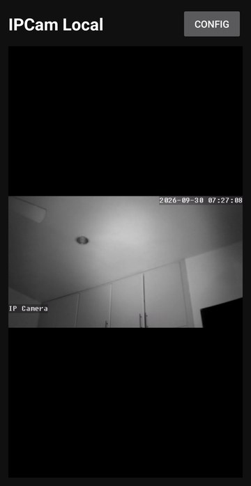

# Case 1 — The video kept eating the screen

**Versions:** 0.9 → 0.12.0 · **Area:** UI / LibVLC

## Symptom

Release after release, the video area grew until the PTZ pad, the PiP and Disconnect buttons
and the background toggle were pushed off screen. Each fix looked right in the XML and broke
again on the phone: a `ScrollView` around the player, `0dp` + `layout_weight`, a fixed height
set in XML and again from Java.

The clearest case: the layout said `android:layout_height="160dp"`, but on the phone the black
video box was roughly **700 dp tall** and nothing else was visible.

<p align="center">
  
  <br><sub>0.11.2: the layout asked for 160 dp. Everything below the video is gone.</sub>
</p>

## Hypotheses

1. The wrong layout file was being built. **Ruled out:** the `activity_main.xml` inside the
   build was identical to the one I was reading.
2. Picture-in-Picture code was resizing the view. **Ruled out:** that code also hides the
   header, and the header was visible.
3. Something outside my code was changing the view's size at runtime.

## Evidence

I downloaded the exact dependency (`org.videolan.android:libvlc-all:3.7.6`) from Maven Central,
extracted `VLCVideoLayout.class` and disassembled it with `javap -c`:

```
protected void onAttachedToWindow();
   ...
   getLayoutParams()
   iconst_m1  ->  LayoutParams.height = -1   // MATCH_PARENT
   iconst_m1  ->  LayoutParams.width  = -1   // MATCH_PARENT
   setLayoutParams(...)
```

`VLCVideoLayout` **overwrites its own size with `MATCH_PARENT` every time it is attached to
the window.** Inside a vertical `LinearLayout`, that means the video takes all the space and
every sibling below it gets 0 px. That explained every previous regression at once, including
why setting the height from Java only worked until the next attach.

## Fix

Stop fighting the library. The video's size is decided by a parent it cannot override:

```xml
<com.ipcamlocal.app.AspectRatioFrameLayout   <!-- height = width × 9/16 -->
    android:layout_width="match_parent"
    android:layout_height="wrap_content">

    <org.videolan.libvlc.util.VLCVideoLayout   <!-- MATCH_PARENT is now harmless -->
        android:layout_width="match_parent"
        android:layout_height="match_parent" />
</com.ipcamlocal.app.AspectRatioFrameLayout>
```

`AspectRatioFrameLayout` measures itself at 16:9 (capped to the available height), and all the
Java code that set the video height was deleted, so the size is defined in **one** place.

<!-- IMAGE: docs/images/case-01-after.png (16:9 video with all controls visible) -->

## Result

Validated on the phone in 0.12.0: 16:9 video, every control visible without scrolling, and the
layout stays correct after PiP, leaving the app and coming back. The same container later made
fullscreen and zoom straightforward.

## Lesson

When a fix "works in the XML" but not on the device, check what the library does at runtime.
Reading the bytecode of the dependency took minutes and ended a long series of layout guesses.
