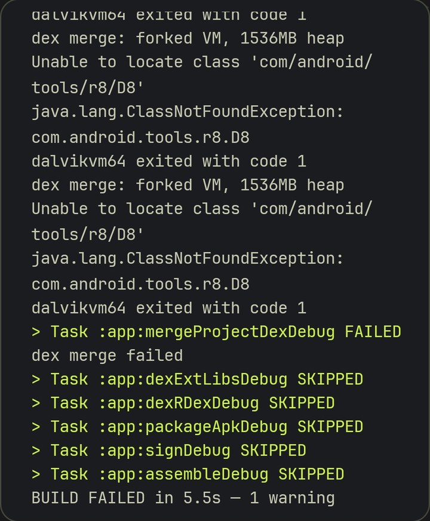

# Case 2 — A build that failed outside my code

**Version:** 0.11.2 · **Area:** Build tooling (CodeAssist on Android)

## Symptom

The whole project is developed and built **on an Android phone** with CodeAssist. After a
round of changes, every build died in the same place:

```
:app:compileJavaDebug     ✓
:app:dexBuilderDebug      ✓
:app:mergeProjectDexDebug ✗
dex merge: forked VM, 1536MB heap
Unable to locate class 'com/android/tools/r8/D8'
java.lang.ClassNotFoundException: com.android.tools.r8.D8
dalvikvm64 exited with code 1
```

<p align="center">
  
  <br><sub>The build log on the phone.</sub>
</p>

## Reasoning

- `compileJavaDebug` passed, so my Java compiled.
- `dexBuilderDebug` also uses D8, and it passed. So **D8 existed inside the IDE's own process**;
  it was missing only in the separate VM the IDE forked for the dex merge.
- The IDE settings for "build in a separate process" and "R8 in the same process" were already
  off/on as expected, and the log still said `forked VM`. Those switches were not the cause.

Changing app code or adding R8 as a dependency could not fix a class missing from the IDE's
own toolchain, so I didn't touch the app.

## The controlled test

An older version, **0.9.0, still built fine on the same phone**. Comparing the build files of
both versions, the only meaningful difference was one line in `gradle.properties`:

| Version | `org.gradle.jvmargs` | Result |
|---|---|---|
| 0.9.0 | `-Xmx2048m` | builds |
| 0.11.2 | `-Xmx1536m` | fails (forked VM reports 1536 MB) |
| 0.11.2 with **only** that line changed | `-Xmx2048m` | **builds** |

One variable changed, and the failure went away.

## What I still don't know

*Why* a 1536 MB heap ends in a `ClassNotFoundException` instead of an out-of-memory error is
internal to CodeAssist, and I can't see it. The practical rule is documented in
[`docs/building.md`](../building.md): keep `-Xmx2048m`.

An earlier write-up of this incident (made before the controlled test) blamed the 2048 MB
setting and recommended deleting it. The test showed the opposite. That's why the conclusion
here is based on the experiment, not on that write-up.

## Lesson

Compare against the last version that worked and change one thing at a time. Read what the log
says (`forked VM, 1536MB heap`) before changing IDE switches or code.
